[English](README.md) | 日本語

<p align="center">
  
</p>

<h1 align="center">Rakitsu</h1>

[](https://github.com/SK-ENT/rakitsu/actions/workflows/ci.yml)
[](https://github.com/SK-ENT/rakitsu/releases)
[](#disclaimer)
[](LICENSE)
[](https://go.dev)

**エージェントのためのIDE** — AIエージェントを視覚的に構築、デバッグ、リリース。

> *rakit*（インドネシア語：組み立てる）+ *jiritsu*（日本語：自律）—「自律的な組み立て」

ドラッグ＆ドロップのキャンバスでマルチエージェントシステムを設計し、ブレークポイントや過去の実行への移動でデバッグ。依存関係のない単一バイナリでデプロイできます。YAMLで設定でき、複数のプロバイダーに対応するオープンソースです。

> **0.4.0 開発プレビュー。** 以下のデモは v0.4.0 マイルストーンで収録しています。クイックスタートでは最新の公開リリースをインストールします。このチェックアウトでプレビューを試すには、`make build-embedded VERSION=v0.4.0-dev` を実行してから `./bin/rakitsu serve` を起動してください。

<p align="center">
  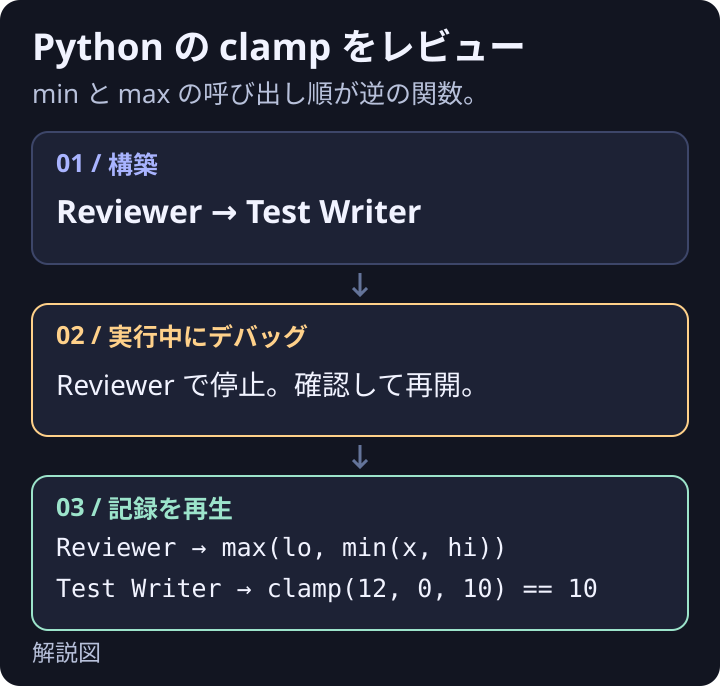
</p>

Reviewer が Python の clamp にある `min` と `max` の取り違えを見つけ、Test Writer が `clamp(12, 0, 10)` の戻り値が `10` になることを確認するテストを提案します。実行中のブレークポイントから完了した実行の記録まで、一連の流れを見てみましょう。
[Web UI マニュアルのワークフロー例を読む](docs/WEBUI.ja.md#build-debug-and-replay-a-code-review)。

## クイックスタート

1. Rakitsu をインストールします。macOS または Linux では、次をターミナルに貼り付けてください。Windows では[リリースページ](https://github.com/SK-ENT/rakitsu/releases/latest)から実行ファイルをダウンロードします。

   ```bash
   curl -fsSL https://raw.githubusercontent.com/SK-ENT/rakitsu/main/install.sh | sh
   ```

2. `rakitsu quickstart` を実行します。Windows ではダウンロード先のフォルダーで PowerShell を開き、`.\rakitsu-windows-amd64.exe quickstart` を実行します。**Chat Bot** と、普段使っているプロバイダーを選択してください。求められたらAPIキーを入力し、案内に従ってプロジェクトを作成します。
3. Web UIを起動するか聞かれたら **Yes** を選択します。自動で開かない場合は **http://localhost:9100** を開き、チャットを始めてください。

ウィザードが設定ファイルを作成します。エディターで使う場合は [Zed クイックスタート](docs/reference/acp.md#quick-start-in-zed)を参照してください。

`rakitsu serve` はフォアグラウンドで動作し、そのターミナルを使い続けます。サーバーとして正常な動作です。起動したままにして、ファイル編集や `rakitsu run` などの操作には**新しいターミナルタブ**を開いてください。Ctrl+C で停止します。

`serve` の起動後、エージェントを実行する方法は2つあります。

- **ブラウザーで Run をクリック** — 実行はすべて `serve` プロセス内で完結します。別のターミナルは不要です。
- **別のターミナルで `rakitsu run config.yaml "query"`** — 独立したCLIプロセスとして実行します。`serve` が起動済みなら http://localhost:9100 にカードがリアルタイムで表示され、デバッガーで確認できます。

Rakitsu 自体は推論を行いません。ローカルで動かす [Ollama](https://ollama.com)、または OpenAI、Anthropic、Gemini、LiteLLM プロキシのAPIキーなど、モデルにアクセスする手段が必要です。

APIキーがない場合は、ウェルカム画面で **Run the Demo** をクリックして Ollama を選んでください。ローカルに Ollama をインストールし、モデルを取得する必要はあります（`ollama pull llama3.2`）が、クラウドのキーは不要です。構成とブレークポイントが設定済みなので、自分で設定を書く前にビジュアルビルダーと実行中のデバッグを試せます。

> **macOS:** リリースバイナリはまだ公証されていないため、初回起動時に Gatekeeper がダイアログなしで `rakitsu` を終了させる場合があります（「killed」とだけ表示）。その場合は `xattr -cr $(command -v rakitsu)` を実行してください。それでも終了する場合は `sudo spctl --add $(command -v rakitsu)`、またはシステム設定 → プライバシーとセキュリティ → **このまま開く**を使います。

### その他のインストール方法

v0.3.2 には `install.sh` または[安定版のダウンロード](https://github.com/SK-ENT/rakitsu/releases/tag/v0.3.2)を使ってください。Homebrew の formula は現在 v0.3.0-alpha.14 に固定されています。

```bash
# Homebrew (macOS / Linux) — formula はこのリポジトリ内
brew tap sk-ent/rakitsu https://github.com/SK-ENT/rakitsu
brew install sk-ent/rakitsu/rakitsu

# Docker (linux/amd64, linux/arm64) — 正確なリリースタグを指定
docker run --rm ghcr.io/sk-ent/rakitsu:v0.3.2 version
docker run --rm -it -e OPENAI_API_KEY -v "$PWD:/workspace" \
  ghcr.io/sk-ent/rakitsu:v0.3.2 run config.yaml "your query"
```

Docker からAPIを公開するには、コンテナー内で `serve` を `0.0.0.0` にバインドする必要があります。これはAPIトークンが設定されている場合にのみ許可されます。ポートは localhost にだけ公開してください。
`docker run --rm -e RAKITSU_API_TOKEN=<token> -p 127.0.0.1:9100:9100 ghcr.io/sk-ent/rakitsu:v0.3.2 serve --host 0.0.0.0`。
ローカルで画面を確認する場合は、コンテナーの外で `rakitsu serve` をループバックにバインドして起動します。APIアクセスについては[サーバー認証](docs/reference/security.md)を参照してください。
コンテナー内で cli ツールの `sandbox: docker` を使うにはホストの Docker ソケットをマウントする必要があり、コンテナーにホストの root 権限を与えることになります。既定の `local_restricted` サンドボックスには不要です。

## 動作を見る

**Debug。** 実行中のコードレビューが、エージェントの思考処理の直前で停止します。グラフと Run Log を確認し、**Resume** で実行を再開します。

<p align="center">
  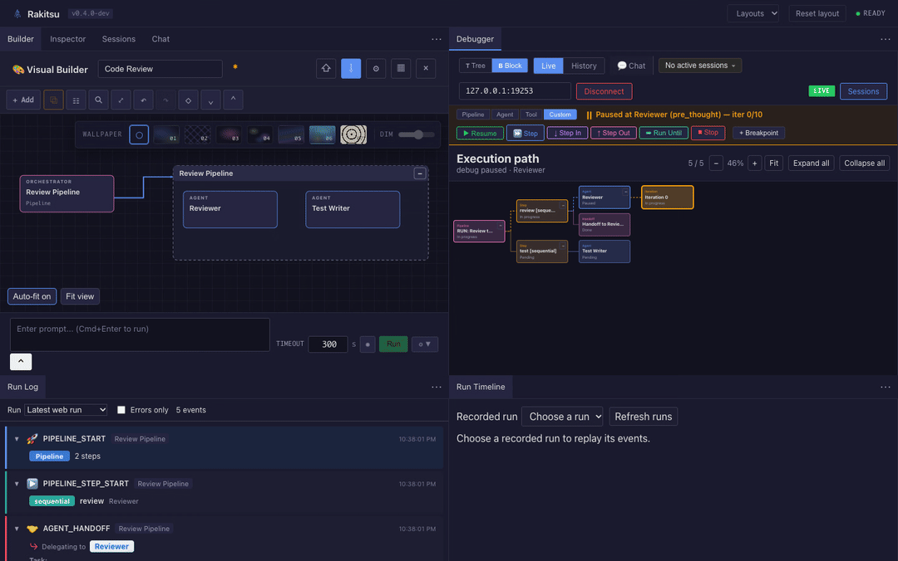
</p>
<p align="center"><sub>ローカルのコードレビューを Debug レイアウトでブレークポイント停止・再開します。</sub></p>

**Builder。** **+ Add** からノードを作成し、**Import** アイコンからパイプラインを読み込めます。デモでは SVG workbench に切り替え、ローカルの Retrieval と Decision ステップを含むパイプラインを折りたたみます。これはレビューの例とは別の、エージェントなしで動作するパイプラインです。

<p align="center">
  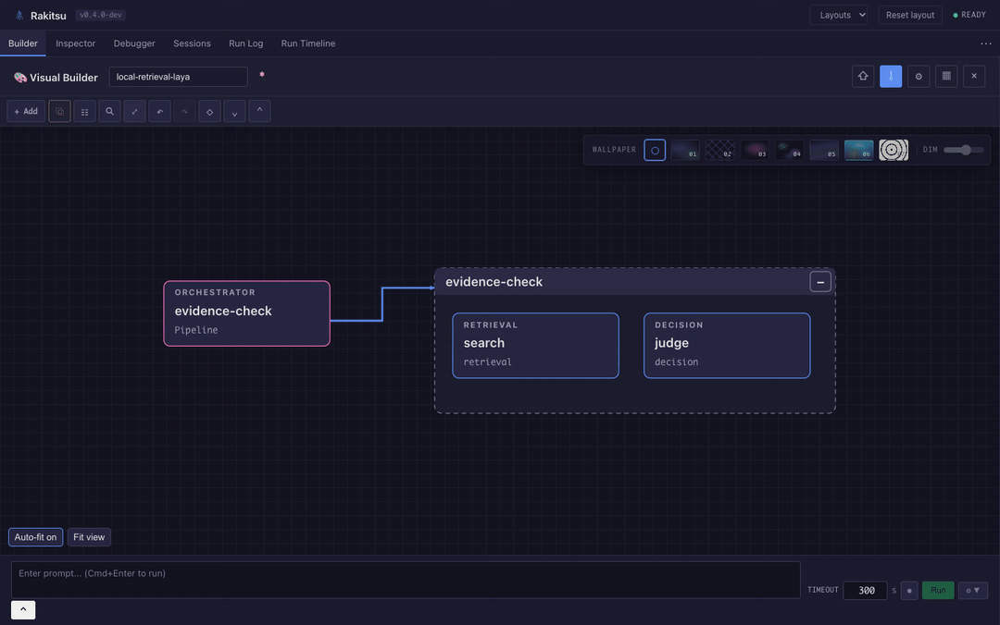
</p>

**Chat。** ローカルの Ollama モデルが、短い Python 関数のバグを説明します。

<p align="center">
  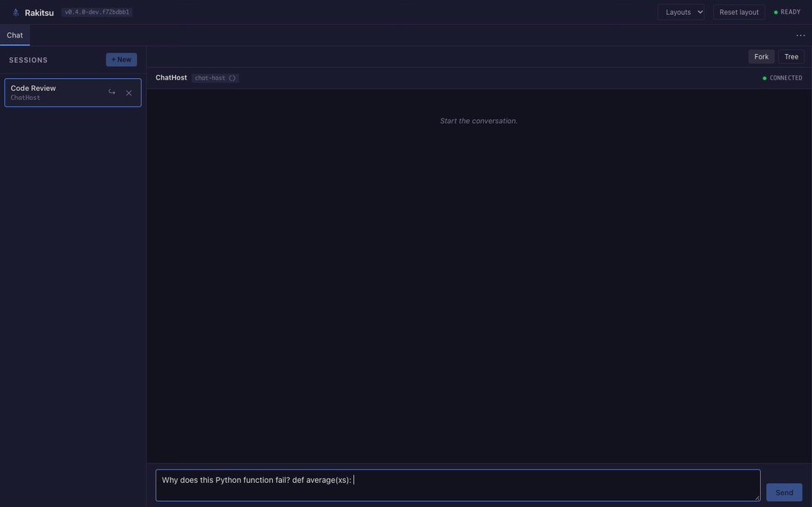
</p>

通しの動画では Builder、実行中のブレークポイント、記録の再生を紹介します。
[MP4の操作動画を見る](docs/assets/showcase/web-ui-workbench.mp4)、または [Web UIマニュアル](docs/WEBUI.ja.md)を開いてください。

## Rakitsu を使う理由

- **視覚的に設計**：コードではなく、ドラッグ＆ドロップのキャンバスでエージェントを設計
- **ソフトウェアと同じようにデバッグ**：ブレークポイント、一時停止、実行途中の推論の確認
- **単一バイナリ**：依存関係なしの1ファイル。ダウンロードして実行
- **YAMLで設定**：宣言的な設定。フレームワークのコードを書く必要なし
- **複数のプロバイダー**：1つの設定で、エージェントごとに OpenAI、Anthropic、Gemini、Ollama を組み合わせ可能

## 機能

**Visual Builder**

- **+ Add** でノードやグループを追加し、キャンバス上で配置・接続
- ドッキングしたレイアウトではコンパクトなアイコン操作。**Run** と **Debug** はラベル付き
- **SVG workbench preview** に切り替えると、直角の接続線を使う別のキャンバスを表示
- 型付きのモデル回答には **Decision**、ローカル文書検索には **Retrieval** を追加
- 設定の継承と上書き：グループで既定値を定義し、エージェントで上書き。状態はバッジで表示
- キャンバス検索、自動配置、階層パネル

**Runtime Debugger**

- 任意のエージェントやツールノードにブレークポイントを設定
- 実行途中で停止し、推論を確認し、パラメーターを上書きして再開
- Tree、Block Diagram、Timeline、Mind Map の4つの表示モード
- **Layouts → Debug** で Builder、Debugger、Run Log、Run Timeline をまとめてドッキング
- **Layouts → Replay** で記録の再生位置を動かし、グラフとログを連動して確認

**Agent Engine**

- 振り返りと根拠確認を備えた ReAct ループ
- 連携戦略：ReAct、Pipeline（Sequential / Parallel / DAG 形式のステップ）。Hierarchical と Plan-and-Execute は現在 ReAct 経由で動作し、独立した実装ではありません
- Pipeline のチェックポイントと再開
- トークン予算の制限、コスト追跡、コンテキストの自動圧縮

**プロバイダー**

- OpenAI、Anthropic Claude、Google Gemini、Ollama、LiteLLM
- 1つの設定内でエージェントごとにプロバイダーを組み合わせ可能
- 任意の OpenAI 互換エンドポイントからモデルを自動検出

**他のランタイムへの移植（任意）**

- 主な実行環境は Rakitsu バイナリ。別のランタイムへ展開するチーム向けに、`RuntimeTarget` インターフェースを通じて設定をエクスポート可能
- 組み込み形式：NemoClaw、OpenClaw。[エクスポートの検証](#export-verification)を参照

**運用**

- セッション履歴、記録の再生、再実行
- CLI と Web UI
- ツールの保護：CLIの許可・拒否リスト、ファイルパス制限、Docker サンドボックス
- リリースバイナリ：Linux / macOS（amd64 + arm64）、Windows（amd64）

**プロトコル連携**

- `rakitsu acp` — ACP（Agent Client Protocol）サーバーとして動作し、Zed などのエディターから Rakitsu エージェントへ直接接続
- `rakitsu acp` は1行につき1つの JSON-RPC メッセージを読み込みます。1行の上限は16 MiB
- `rakitsu acp` が保持するセッションは最大 `--max-sessions` 件（既定256）。`--session-idle-timeout`（既定24h）以上使われていないセッションを削除します。プロンプトの実行中は削除しません
- `rakitsu serve --config tools.yaml --mcp-port 9200` は別リスナーの `http://localhost:9200/mcp` に MCP サーバーを公開します（旧仕様、リビジョン ≤2025-11-25）。外部の MCP クライアントから Rakitsu のツールを検出・呼び出し可能
- `rakitsu serve --config team.yaml` は新しいタスクごとに A2A 設定と同階層のスキルを再読み込みします。ほかの検出済み設定は `/a2a/{config-id}`、そのカードは `/.well-known/agent-card.json/{config-id}` で利用できます。任意の MCP リスナーも、ツール定義の変更時に登録情報を更新します。エージェント設定の追加・編集でサービスの再起動は不要です
- `mcp_server`、`a2a`、`jev` ツールで、エージェントから外部の MCP サーバー、A2A エージェント、TypeSafe AI の Jev モデルを呼び出せます。Jev は yes/no、択一、スコア付きの型付き質問に対応

## 長時間動作するモニター

実験的な機能です。チャットセッションはタイマー（`settings.wake`）で自分自身を起動し、確認を行い、重要なことがある場合だけ通知できます。`rakitsu serve --config monitor.yaml` は `monitors:` ブロックからセッションを自動起動できるため、監視プロセス（Docker、systemd、launchd）が再起動するのは1つのプロセスだけです。

- `GET /healthz` は全モニターが正常なら200、それ以外は503を返します。`rakitsu healthcheck` は Docker 向けのラッパーです
- 状態確認と制御：`GET /api/chat/{id}/wake/status`、`POST .../wake/stop`、`POST .../wake/resume`、`/wake` スラッシュコマンド、Web UIの状態カード
- 通知はホストの許可リストを持つサーバー側の送信先（webhook、ntfy）から送ります。エージェントは `send_alert` ツールでメッセージをキューに入れるだけです
- 検証状況：タイマーのロジックは模擬時計でテスト済み。実環境で数日間続ける試験は進行中で、まだ実証できていません

詳細：[docs/wake-timer.md](docs/wake-timer.md)、[docs/monitor-autostart.md](docs/monitor-autostart.md)。デプロイ用ファイルは [deploy/monitor/](deploy/monitor/) にあります。

## 壁紙

エージェントが考えている間に眺めるものを。Builder のキャンバスには、エージェントの背後で動くシェーダーを表示できます。プリセットは7種類。既定ではオフで、Settings パネルから選択します。

Water Ripple は鯉の池です。**F** で餌を落とすと鯉が現れます。**Shift+F** では釣り上げられます（ピクセルなので許してくれます）。**R** で雨が降ります。以下は Builder キャンバスの Water Ripple です。

<p align="center">
  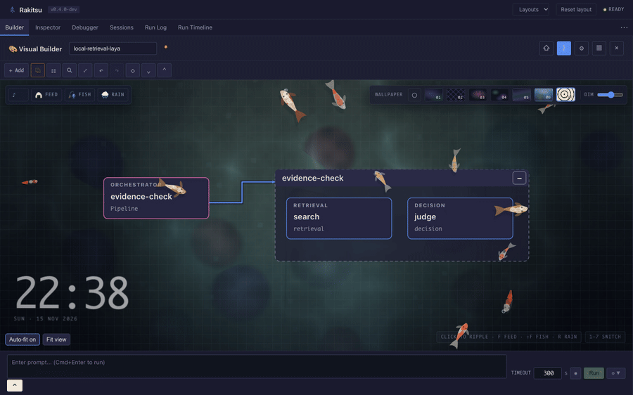
</p>

<details>
<summary>エージェントIDEに、なぜ鯉の池？</summary>

夜11時、厄介な不具合をデバッグしながら、私はいつものように読み込み中のスピナーをにらんでいました。通りかかった娘が画面を見て、こう言ったのです。「これをやってるとき、いつもイライラしてるね。鯉でも置けば？ 考えてる間に、きれいなものを見られるように」

子どもの一言で、私の生活への指摘とUXの改善が同時に済みました。

</details>

残りの6種類：

| | | |
|:-:|:-:|:-:|
| 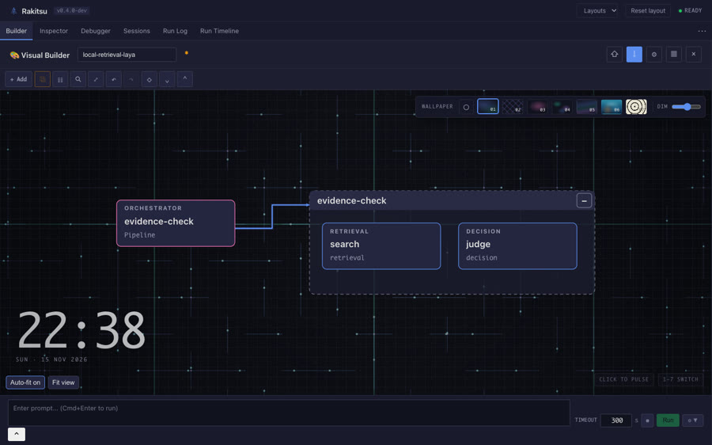<br>Circuit Flow | 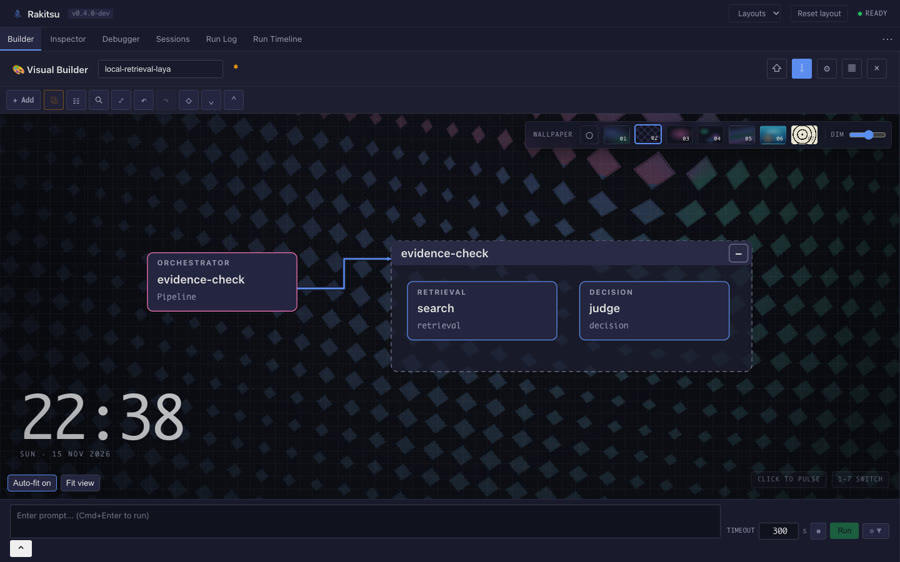<br>Plasma Lattice | 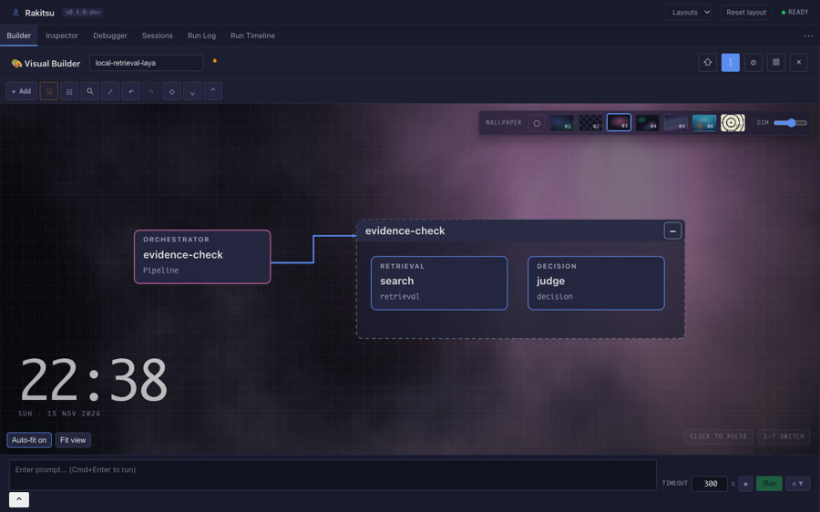<br>Volumetric Fog |
| 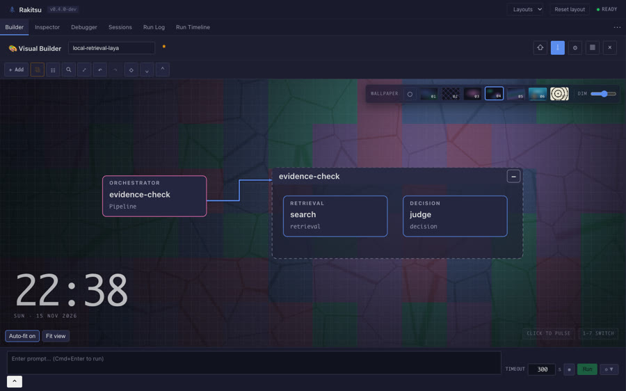<br>Voronoi Cells | 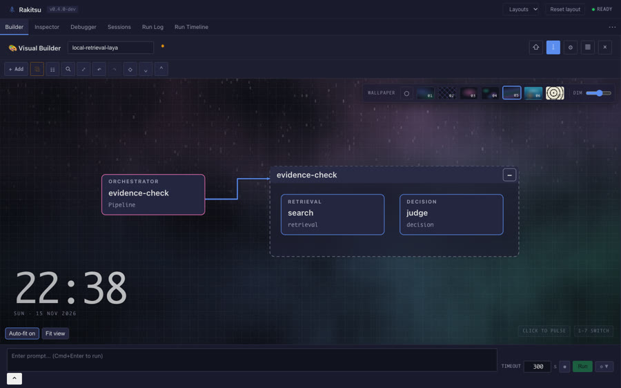<br>Aurora Waves | 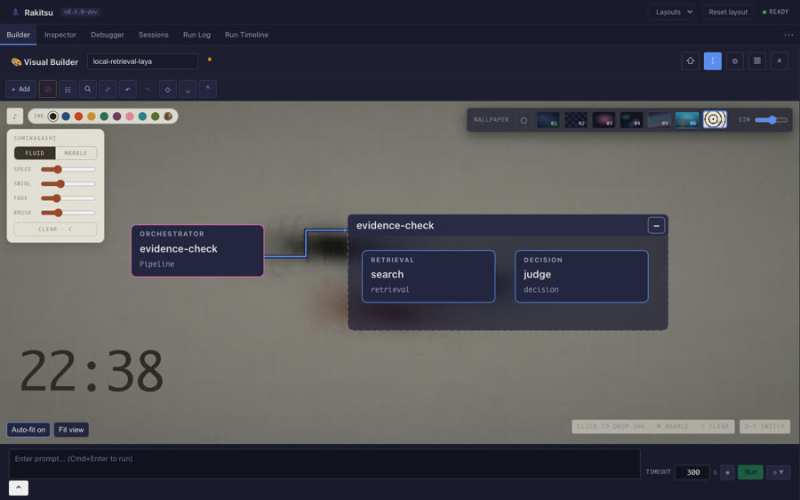<br>Suminagashi |

## CLI

```bash
rakitsu quickstart                    # 対話式プロジェクト作成ウィザード
rakitsu serve                         # Web UI + エージェント実行
rakitsu serve --config tools.yaml --mcp-port 9200  # A2A: 9100、MCP: localhost:9200/mcp
rakitsu run config.yaml "query"       # CLIからエージェントを実行
rakitsu acp                           # ACPサーバーとして実行（Zedなどのエディター連携）
rakitsu scaffold code-review          # テンプレートから設定を生成
rakitsu sessions                      # 過去の実行を閲覧
rakitsu doctor config.yaml            # 実行前に設定とプロバイダーの状態を診断
rakitsu healthcheck                   # 起動中の serve の /healthz を確認（終了コード0 = 正常）

# 実行時にプロバイダーとモデルを上書き（設定の編集は不要）:
rakitsu run config.yaml "query" --provider openai --model gpt-5.6-luna
rakitsu run config.yaml "query" --provider ollama --model llama3
```

## 設定例

```yaml
name: Code Reviewer
settings:
  default_provider: openai
  providers:
    openai:
      type: openai
      api_key: ${OPENAI_API_KEY}
      reasoning_effort: none
  defaults:
    model: gpt-5.6-luna

tools:
  - name: read_file
    type: fs
    operation: read

agents:
  - name: Reviewer
    role: worker
    provider: openai
    model: gpt-5.4
    system_prompt: Review code for bugs, security issues, and best practices.
    tools: [read_file]

orchestrator:
  name: Lead
  strategy: Pipeline
  agents: [Reviewer]
  pipeline:
    steps:
      - name: review
        agent: Reviewer
        task: Review the supplied query.
```

任意の設定ブロック：

```yaml
settings:
  spawn:              # runtime subagent fan-out (spawn_agent tool)
    enabled: true
    max_concurrent: 3 # run-global cap on concurrent children (default 4)
    max_depth: 1      # children cannot spawn further (default)
    timeout_seconds: 300
```

`settings.spawn.enabled` を有効にすると、すべてのエージェント（対話型チャットのホストを含む）が `spawn_agent` ツールを使えます。実行時に、その場限りのワーカーや設定済みエージェントの複製を並列起動できます。子エージェントにはそれぞれタイムアウトがあり、親との関係を明示して同じトレースとデバッガーへストリーム表示されます。[examples/single/10-spawn-fanout/](examples/single/10-spawn-fanout/) を参照してください。

チャットボット、開発チーム、パイプライン、RAGアシスタントなどは [examples/](examples/) にあります。

<a id="export-verification"></a>
## エクスポートの検証

Rakitsu の `RuntimeTarget` エクスポートは、実際のインフラとHTTPトレースでエンドツーエンド検証しています。現在の実装は OpenClaw と NVIDIA NemoClaw に対応しています。各検証環境は以下のとおりです。

### 検証済みの項目

| 対象 | 検証したランタイム | 結果 |
|-----------|-----------------------|--------|
| `openclaw.json` | `ghcr.io/openclaw/openclaw:latest`（Docker） | Rakitsu が生成した設定でゲートウェイが起動 |
| `sandbox-policy.yaml` | DGX Spark（aarch64）上の NVIDIA OpenShell | `Policy version 2 loaded (active)` |
| NemoClaw サンドボックス全体 | docker-in-docker 内の NemoClaw CLI。Landlock+seccomp+netns でサンドボックスを作成 | `Policy version 6 loaded (active)` |
| エンドツーエンドの推論 | NemoClaw サンドボックス → egress proxy → DGX Spark Nemotron-30B | **HTTP 200 の chat completion** |

### E2Eテストの構成

```
docker:dind (local host)
  └── NemoClaw CLI + OpenShell gateway (k3s-in-Docker)
       └── Sandbox "my-assistant" (Landlock + seccomp + netns)
            └── OpenClaw agent
                 └── Rakitsu-exported openclaw.json  ←── our export
                 └── Rakitsu-exported sandbox-policy  ←── our export
                 └── HTTP request to DGX Spark (via egress proxy)
                      └── LiteLLM → vLLM → Nemotron-30B
                           └── HTTP 200 chat completion ✓
```

検証後は `docker rm -f` ですべてのファイルを破棄し、状態を残していません。負荷の大きいE2Eテストは**手動実行のみ**です。エクスポートのスキーマ（バイナリ許可リスト、ポート抽出、環境変数展開）はユニット回帰テストで保護し、CIの各ビルドで実行します。

検証記録の全体は [docs/EXPORT-VERIFICATION.md](docs/EXPORT-VERIFICATION.md) を参照してください。

## ソースからビルド

```bash
git clone https://github.com/SK-ENT/rakitsu.git
cd rakitsu
make build-embedded    # フロントエンド + Go バイナリ → bin/rakitsu
./bin/rakitsu serve
```

必要環境：Go 1.26+、Node.js 20.19+ または 22.12+

## プロジェクト構成

```
cmd/rakitsu/        CLIのエントリーポイント（Cobra）
internal/agent/     ReActループ、オーケストレーター、パイプライン実行
internal/llm/       LLMプロバイダーのインターフェースと実装
internal/tools/     ツールのインターフェース：cli/, fs/, mcp/, a2a/, memory/, alert/
internal/wake/      起動タイマーエンジン（確認、ルール、タスク）
internal/alert/     通知先（webhook、ntfy）、機密情報の除去、送信頻度の制限
internal/server/    SSEハブ、エージェント実行、設定ストア
internal/debug/     デバッグ制御、再生、ブレークポイント
internal/store/     セッション永続化（JSONL、セッションごとに1ファイル）
web/src/            Vue 3 + Vue Flow フロントエンド
examples/           そのまま実行できるYAML設定
```

## トラブルシューティング

**"openai API key not set"** — 実行前にキーをエクスポートしてください。
```bash
export OPENAI_API_KEY=sk-...
```

**"cannot load config: no such file or directory"** — 設定ファイルのパスを確認してください。`ls examples/single/` で利用できる設定を確認できます。

**"cannot create provider for agent …"** — エージェントが未定義のプロバイダーを参照しています。設定の `settings.providers` に追加し、エージェントの `provider:` がその名前と完全一致することを確認してください。

**"is port 9100 already in use?"** — 別の `rakitsu serve` が動いている可能性があります。停止するか、別のポートを使ってください。
```bash
rakitsu serve --port 8080
```

**複数インスタンスの実行** — 各インスタンスに専用のセッションディレクトリとメモリーディレクトリを指定してください。`--sessions-dir PATH`（`serve`、`run`、`sessions`）、または `settings.sessions_dir` と、`settings.memory.dir` を使います。実行中のインスタンス間で同じディレクトリを共有しないでください。`sessions.json` のインデックスは複数の書き込み元に対応していません。既定は `~/.rakitsu/sessions` です。`run --hub URL` が選ぶのはライブイベントの送信先だけで、そのサーバーの履歴ディレクトリは引き継ぎません。`run` と `serve` の履歴は明示的に設定してください。ライブで表示されても、保存済み履歴が見えるとは限りません。詳細：[docs/configuration.md](docs/configuration.md#running-isolated-instances)。

**エージェントは動くが出力がない** — `--trace` で実行の詳細を確認します。
```bash
rakitsu run config.yaml "query" --trace --verbose
```

**実行が早く止まりすぎる、または長すぎる** — 既定では時間制限はなく、`max_iterations` 未指定のエージェントには反復回数の上限もありません。回答、予算（`max_cost` / `max_total_tokens`）、`--idle-timeout`、Ctrl+C のいずれかで終了します。`--timeout` で制限を指定できます（秒単位。`--interactive` ではターンごと）。
```bash
rakitsu run config.yaml "query" --timeout 600
```

**出力が `[REASONING-ONLY OUTPUT — …]` で始まる** — モデル（主に nemotron、DeepSeek-R1、QwQ）が、利用者向けの回答を出す前に思考過程だけで `max_tokens` を使い切っています。[docs/providers/reasoning-models.md](docs/providers/reasoning-models.md) では実運用向けの3つの選択肢を紹介しています。既定のまま回答抽出に任せる、回答の統合を Gemini に切り替える、またはハイブリッド構成（ローカルのワーカー + クラウドでの統合）を使う方法です。

## 開発のきっかけ

Rakitsu は2026年春、息子を支えるための小さなプロジェクトとして始まりました。小さく収まるはずでしたが、そうはなりませんでした。取り組む課題そのものが面白く、本格的な長期プロジェクトへと育ちました。根底にあるのは今も家族のためのプロジェクトです。

Rakitsu はAIの利用を公開し、人間とAIコーディングアシスタントが共同開発しています。設計判断、コードレビュー、最終検証は人間が行い、実装の多くはAIの支援を受けています。AIツールとライセンスの関係は [`AI_USE_NOTICE.md`](AI_USE_NOTICE.md) を参照してください。

<a id="disclaimer"></a>
## 免責事項

> **Rakitsu はプレビュー段階です。** 個別のリリースには alpha、beta、stable の表示が付く場合があります。インターフェース、API、動作は予告なく変更される可能性があります。Rakitsu はLLMが生成したツール呼び出し（シェルコマンドやファイル操作）を実行するため、本質的なリスクを伴います。利用者の責任でお使いください。本ソフトウェアの利用により生じたいかなる損失、損害、結果についても、作者は責任を負いません。条項の全文は [LICENSE](LICENSE) を参照してください。

## ライセンス

BSL 1.1。詳細は [LICENSE](LICENSE) を参照してください。4年後に Apache 2.0 へ移行します。

**AIツールの利用**：[`AI_USE_NOTICE.md`](AI_USE_NOTICE.md) を参照してください。AIツールを使った読解や個人的な学習は問題ありません。AIで加速した競合製品の再実装には BSL の競業禁止条項が適用されます。

## リンク

- [使用例](examples/)
- [コントリビューション](CONTRIBUTING.md)
- [ドキュメント](https://sk-ent.github.io/rakitsu/latest/)
- [リファレンス](docs/reference/index.md)
- [ACP と Zed の設定](docs/reference/acp.md)
- [開発ガイド](docs/DEVELOPMENT.md)
- [システム仕様](docs/SYSTEM-SPEC.md)
- [リリース履歴](https://github.com/SK-ENT/rakitsu/releases)
- [謝辞](docs/ACKNOWLEDGMENTS.md)
