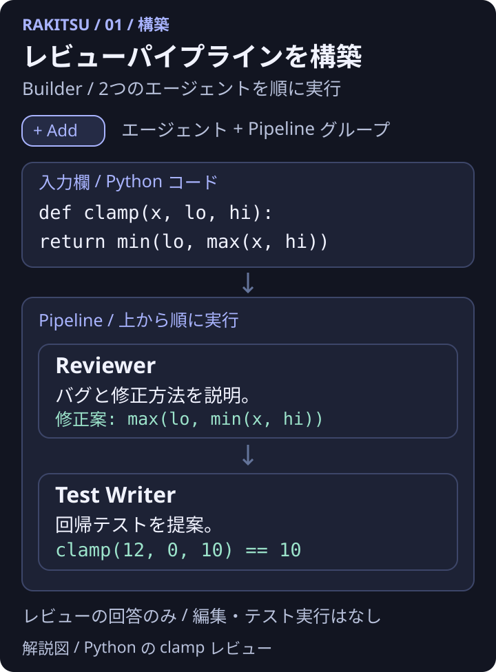
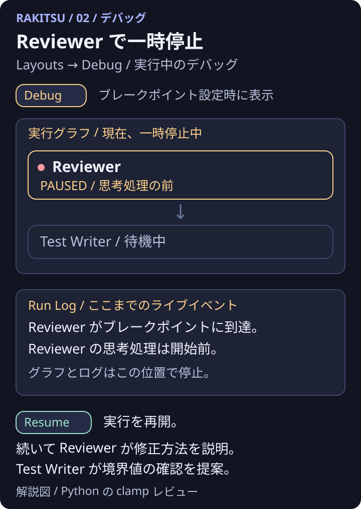
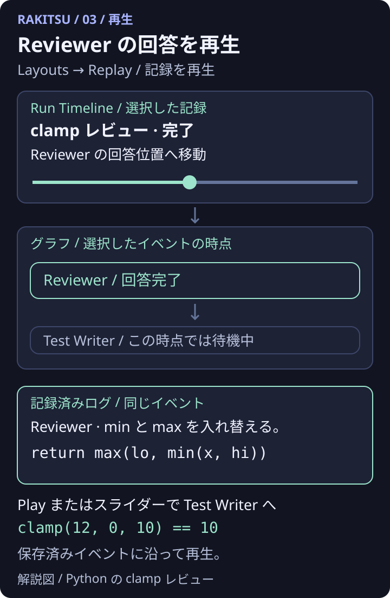

[English](WEBUI.md) | 日本語

# Rakitsu Web UIマニュアル

## 概要

このマニュアルは 0.4.0 開発版のワークスペースを説明します。

Rakitsu の Web UI は、`rakitsu serve` で起動する多機能なエージェントIDEです。ワークスペースには、ドッキング可能な7つのパネルがあります。

- **Builder** — ドラッグ＆ドロップでエージェントを視覚的に設定
- **Debugger** — ブレークポイントを使ったリアルタイムの実行監視
- **Inspector** — イベントストリームの表示
- **Sessions** — セッション履歴の表示と確認
- **Chat** — エージェントとの対話
- **Run Log** — 最新の実行、選択したセッション、または受信した全イベントの表示
- **Run Timeline** — 記録した実行の再生とイベントの詳細表示

UIを起動します。
```bash
rakitsu serve --port 9100
# http://localhost:9100 を開く
```

**初回起動で設定一覧が空の場合：** `serve` は、実行したディレクトリを基準に `.`、`./examples`、`./configs`（または `--config-dir`）で見つかった設定だけを表示します。まだプロジェクトがなければ、先に `rakitsu quickstart` を実行してください。自分で設定を書く前に `examples/` から1つ選んでUIを試すこともできます。

---

## ワークスペースのレイアウト

**Layouts → Debug** を選ぶと、Builder の隣に Debugger の Block グラフ、その下に Run Log と Run Timeline が配置されます。ログは別のソースを選ぶまで、Web UIでの最新の実行に追従します。**Layouts → Replay** では実行グラフを広く表示できます。Run Timeline で記録を選び、**Play** またはスライダーを使うと、グラフと記録済みログの表示位置が連動して移動します。プリセットを切り替えても、選択中の記録と再生位置は保持されます。狭いウィンドウではパネルが縦に並びます。

各パネルの **⋯** メニューで、フロート表示、ドッキング、最大化、別のタブグループへの移動ができます。タブまたはフロート表示のタイトルバーをドラッグすると、所定の位置にスナップします。
Builder では入力欄の山形アイコンでプロンプトの操作領域を折りたたみ、キャンバスを広げられます。再び開くときもプロンプトと実行設定は保持されます。Builder のフッターには最近の実行が表示されます。

[0.4.0 Web UIの操作動画を見る](assets/showcase/web-ui-workbench.mp4)。
Builder のパイプライン、Debug レイアウトでのブレークポイント、Replay レイアウトでの記録の再生を紹介しています。

<a id="build-debug-and-replay-a-code-review"></a>
## Python コードレビューのワークフロー例

以下の解説図は、2つのエージェントによるレビューの流れを示します。録画では実際のワークスペースの操作を紹介しており、エージェントなしで動く別の Retrieval → Decision パイプラインも登場します。

1. **2つのステップを作成する。** **Settings** でプロバイダーとモデルを設定します。**+ Add** で Orchestrator、Pipeline グループ、Reviewer と Test Writer という名前の2つのエージェントを作成します。Orchestrator をグループに接続します。両エージェントをグループ内へドラッグし、**Add to group** で確定してください。Reviewer を Test Writer より上に置くと、Pipeline グループがその順に実行します。Reviewer にはバグと修正方法の説明、Test Writer にはレビューをもとにした回帰テストの提案を指示します。Builder の入力欄に次の Python コードを入力してください。

   ```python
   def clamp(x, lo, hi):
       return min(lo, max(x, hi))
   ```

   `min` と `max` の呼び出しが逆になっています。意図する修正は `max(lo, min(x, hi))`、テスト案は `clamp(12, 0, 10) == 10` です。エージェントは回答の中で修正とテストを提案します。

   

2. **実行中にデバッグする。** Reviewer の Builder コンテキストメニューで **Break before thought** を選びます。ブレークポイントを設定すると、入力欄に **Debug** が表示されます。**Layouts → Debug** を選び、**Debug** で開始してください。ブレークポイントで停止したら、グラフ内の Reviewer と、それまでに **Run Log** が受信したイベントを確認します。この時点では Reviewer の思考処理はまだ始まっておらず、Test Writer も待機中です。**Resume** をクリックすると実行が再開します。記録を再生できるように、両ステップを最後まで実行してください。

   

3. **完了した記録を再生する。** **Layouts → Replay** を選び、**Run Timeline** で完了した実行を選択します。スライダーを Reviewer の回答完了位置まで動かしてください。グラフと記録済みの **Run Log** は同じイベントに追従します。その時点では Reviewer が修正方法を説明済みで、Test Writer はまだ待機中です。**Play** またはスライダーで先へ進むと、Test Writer が提案した `clamp(12, 0, 10) == 10` の確認を見られます。再生は、保存済みイベントの閲覧位置を移動する操作です。

   

## Visual Builder

**+ Add** からノードやグループを作成します。アイコンにカーソルを合わせると操作名が表示されます。**Tab** で **+ Add** 内の選択肢に移動でき、**Esc** で閉じるとボタンにフォーカスが戻ります。入力欄には **Run**、ブレークポイントがある場合は **Debug** が表示されます。

ツールバーの **SVG workbench preview** でキャンバスを切り替えます。**Classic canvas** で既定の表示に戻ります。**Arrange** は SVG プレビューを左から右へ整列します。グループの折りたたみボタン、またはツールバーの **Fold all** / **Unfold all** を使えます。

実行を開始すると Builder は **Execution Path** を開きます。実行中に設定済みのグラフを見るには **Show Workflow** を使います。実行後は **Back to Canvas** で編集に戻り、**Show Results** で実行グラフを再表示できます。

### キャンバスの基本操作

| 操作 | 方法 |
|---|---|
| キャンバスを移動 | 空白部分をクリックしてドラッグ |
| ズーム | マウスホイールまたはピンチ操作 |
| 全体を表示 | 左下の操作ボタンにある fit-view をクリック |
| ノードを追加 | **+ Add** を開き、Agent、Tool、Skill、Orchestrator を選択 |
| ノードを移動 | ノードをクリックしてドラッグ |
| ノードを接続 | 接続元のハンドルから接続先のハンドルへドラッグ |
| ノードを編集 | ノードをクリックしてサイドパネルのエディターを開く |
| ノードを削除 | ノードを選択し、Delete または Backspace |
| 右クリックメニュー | ノードを右クリックしてコンテキスト操作を表示 |

### ノードの種類

| 種類 | 用途 | 接続ハンドル |
|---|---|---|
| **Agent** | LLMを使うワーカーまたは監督役 | 入力（上）、ツール・スキルへの出力（下） |
| **Tool** | CLIコマンド、ファイル操作、MCPサーバー呼び出し、A2A委任 | 入力（上） |
| **Skill** | 再利用できるツールとプロンプトの組み合わせ | 入力（上） |
| **Orchestrator** | エージェントの連携戦略を管理 | 入力（上）、エージェントへの出力（下） |
| **Group** | ノードをまとめるコンテナー | 入力（上）、出力（下） |
| **Decision** | 型付きの質問を行い、エージェントのステップへ振り分け可能 | 分岐の接続線は Decision の設定から生成 |
| **Retrieval** | ローカルの文書群を検索し、出典付きの抜粋を返す | 検索結果を使う設定の Decision に根拠の接続線でつなぐ |

Pipeline グループを選択すると、**+ Add** で **Decision** と **Retrieval** が選べます。
Decision エディターではバックエンド、質問、振り分け先を設定します。
Retrieval エディターでは文書群のディレクトリを設定し、`RAKITSU_RETRIEVAL_ROOT` を承認済みの文書群に向けて `rakitsu serve` を起動してください。根拠の入力ルールは[パイプラインのリファレンス](reference/agents-orchestrators.md#decision-and-retrieval-steps)を参照してください。

### 接続ルール

| 接続元 | 接続できる対象 |
|---|---|
| Orchestrator | Agent、Orchestrator、Group |
| Agent | Tool、Skill、Agent、Orchestrator、Group |
| Group | Agent、Tool、Skill、Orchestrator、Group |
| Tool | 末端ノード。出力接続なし |
| Skill | 末端ノード。出力接続なし |

---

## 複数選択

| 操作 | 方法 |
|---|---|
| 範囲選択 | キャンバスの空白部分で **Shift + drag** |
| ノードの選択を切り替え | **Cmd + click**（Mac）/ **Ctrl + click**（Win） |
| 同じ階層をすべて選択 | Shift+drag で現在のスコープ内の全ノードを囲む |
| 選択をすべて解除 | キャンバスの空白部分をクリック、または **Escape** |

### 一括操作

複数のノードを選択すると **Bulk Edit** パネルが表示されます。

- 選択したノードの数と種類を表示
- すべて同じ種類（すべて Agent など）なら、共通フィールド（プロバイダー、モデル）を編集可能
- **Duplicate** — 選択した全ノードと、その間の接続線を複製
- **Delete** — 確認後、選択した全ノードを削除

---

## ブロックプログラミング（グループ）

### グループの作成

| 方法 | 操作 |
|---|---|
| 空のグループ | **+ Add** を開き、**Pipeline**、**Parallel**、**Team**、**Loop**、**Group** を選択 |
| 選択したノードをグループ化 | 2つ以上のノードを選び、**Group selection** アイコンを使用 |
| 右クリックメニュー | 複数選択 → 右クリック → "Group as Pipeline/Parallel/Team" |

### グループの種類

| 種類 | 色 | 実行上の意味 |
|---|---|---|
| **Pipeline** | 青 | 子ノードを上から下へ順に実行 |
| **Parallel** | 緑 | 子ノードを並列に実行 |
| **Team** | ピンク | オーケストレーターが子ノードを階層的に管理 |
| **Generic** | グレー | 見た目上のグループ化のみ。実行動作への影響なし |

### グループへノードを追加

| 方法 | 操作 |
|---|---|
| ドラッグ＆ドロップ | ノードをグループに重ねて離し、重ねて表示されるメニューで "Add to group" |
| 入れ子のグループ | ノードを入れ子のグループに重ねると、該当する最も深いグループが対象 |
| 親グループを変更 | ノードを別のグループへドラッグして移動 |

ドラッグ中、対象のグループは**青く光って強調表示**され、配置先を示します。

### グループからノードを取り出す

| 方法 | 操作 |
|---|---|
| グループを解除 | グループを選択 → **Ungroup** をクリック、または右クリック → Ungroup |
| 外へドラッグ | 先にグループのスコープに入り、ノードを外へドラッグ |

### グループの特性

- **サイズ変更可能** — グループを選択し、角や辺のハンドルをドラッグ
- **最小サイズ** — 250 × 120 ピクセル
- **接続可能** — 接続線用の入出力ハンドルを持つ

---

## スコープに基づく選択

選択操作は、Maya や Figma のように**階層ごとのスコープ**に従います。

### スコープ間の移動

キャンバス上部中央に**スコープウィジェット**が表示されます。

```
[ Canvas ] | Enter: [ Pipeline ] [ Team ]     ← 最上位
[ Canvas ] / [ Pipeline ] [ ↑ Up ]            ← Pipeline の内部
[ Canvas ] / [ Pipeline ] / [ Parallel ] [ ↑ Up ]  ← 入れ子
```

| 操作 | 方法 |
|---|---|
| グループに入る | グループを**ダブルクリック**、またはスコープウィジェット内の名前をクリック |
| グループから出る | **Escape**、**↑ Up**、またはスコープのパス内の親をクリック |
| 最上位へ移動 | スコープウィジェットの **Canvas** をクリック |

### 選択ルール

1. **同じ階層だけ** — 現在のスコープと同じ階層のノードだけを選択できます
2. **親の選択を優先** — グループを選択している間、そのメンバーは個別に選択できません
3. **グループを選ぶと子孫の選択を解除** — 矛盾する選択を解消します
4. **グループも選択可能** — 現在の階層のグループを複数選択に含められます
5. **種類の混在が可能** — 同じ階層ならグループと通常のノードを一緒に選べます

---

## Settings パネル

ツールバーの**歯車アイコン**で開きます。

### サービスプロバイダー

エージェントの設定前に、LLMプロバイダーを定義してください。

1. **+ Add Service Provider** をクリック
2. **Name** を設定（例："my-openai"、"litellm-proxy"）
3. **Type** を設定（openai、anthropic、gemini、ollama、litellm）
4. **Default Model** を設定。base_url が設定済みならプロキシから自動検出
5. 必要に応じて **API Key** と **Base URL** を設定

### 既定値

- **Default Provider** — 定義済みのプロバイダーだけを選択肢に表示
- **Default Model** — 既定のプロバイダーから自動検出
- **Temperature**、**Max Tokens** — 継承と上書きの仕組みを通じてエージェントに適用

### 継承と上書き

自動入力される値はすべて、**継承と上書き**の仕組みに従います。

| バッジ | 意味 |
|---|---|
| **inherited**（青） | 値が継承元（プロバイダーの既定モデルなど）と同期 |
| **reset** ボタン | 手動の上書きを取り消し、継承した値に戻す |

**継承できるフィールド：**

- `model` ← プロバイダーの default_model
- `temperature` ← settings.defaults.temperature
- `max_tokens` ← settings.defaults.max_tokens
- `max_iterations` ← settings.execution.max_iterations
- `timeout` ← settings.execution.timeout_seconds

継承元（プロバイダーの既定モデルなど）を変更すると、継承中の全エージェントが自動更新されます。手動で上書きした値は変更されません。

---

## 参照の整合性

すべての要素は**内部用の安定したID**（`_id`）を持ちます。名前を変更しても参照は保たれます。

| 名前の変更対象 | 自動更新される参照 |
|---|---|
| プロバイダー | 全エージェントとオーケストレーターの `provider` |
| ツール | 全エージェントと全スキルの `tools[]` |
| スキル | 全エージェントの `skills[]` |
| エージェント | オーケストレーターの `agents[]`、パイプラインステップの `agent` |

YAMLのエクスポート時にIDを除去するため、内部メタデータのない設定を出力できます。

---

## ノードエディター

ノードをクリックすると、サイドパネルにエディターが開きます。

### Agent のフィールド

| フィールド | 説明 |
|---|---|
| Name | エージェントの識別名（YAMLと参照で使用） |
| Role | `worker` または `supervisor` |
| Provider | 定義済みのプロバイダーから選択 |
| Model | プロバイダーから自動検出、または任意の値を入力 |
| System Prompt | エージェントへの指示（複数行テキスト） |
| Tools | キャンバス上のツールをチップで複数選択、または任意の値を入力 |
| Skills | キャンバス上のスキルをチップで複数選択 |
| Vision | 画像入力への対応を有効化 |
| Model Config | Temperature、max tokens、top P、ペナルティ |
| Agent Settings | 最大反復回数、タイムアウト、振り返り、根拠確認 |

### ComboBox のドロップダウン

すべてのドロップダウンは独自の **ComboBox** コンポーネントを使います。

- クリックすると全選択肢を表示
- 入力すると絞り込み（入力文字が順番どおりに含まれる候補に逐次一致）
- **A/F** ボタンで全表示（All）と絞り込み（Filter）を切り替え
- 任意の値も入力可能（入力して Enter）

---

## Debugger

### モード

| モード | 説明 |
|---|---|
| **Run** | エージェントを実行し、イベントを配信（デバッグの追加負荷なし） |
| **Debug** | デバッガーを接続。ブレークポイント、一時停止・再開、パラメーターの上書きが可能 |

### セッションパネル（右側）

- **Live** タブ — 実行中と最近の実行
- **History** タブ — JSONLのセッションストアに保存された過去のセッション
- **Search** — チップ形式で逐次絞り込み（名前、クエリ、エージェント、状態、設定パス）
- **Delete** — 確認付きの個別削除・一括削除
- **サイズ変更可能** — 左端をドラッグして幅を調整

### グラフの表示形式

**Tree**、**Block** ボタンで切り替えるか、ほかのグラフ形式を開きます。

| 形式 | 用途 |
|---|---|
| **Tree** | コンパクトな階層表示。最も詳細な情報 |
| **Block** | 実行カードと、実行の流れを視覚的に表示 |
| **Timeline** | 時間軸に沿った横方向の表示 |
| **Mind Map** | 放射状のレイアウト |

### ブレークポイント

特定の位置で実行を停止するために設定します。

| 方法 | 操作 |
|---|---|
| ブレークポイントバー | ツールバーでイベントの種類とエージェント名を選択 |
| ツリーのコンテキストメニュー | ノードを右クリック → "Set Breakpoint" |
| インラインボタン | ツリーのノードを選択 → **BP** |
| Builder のコンテキストメニュー | エージェントを右クリック → "Break before thought/tool/agent" |

**対応するチェックポイント：**
`AGENT_START`、`THOUGHT_START`、`THOUGHT_END`、`TOOL_CALL_START`、`REFLECTION_START`、`GROUND_CHECK_START`、`PIPELINE_STEP_START`

### 一時停止中の操作

| 操作 | 説明 |
|---|---|
| **Resume** | 通常どおり実行を再開 |
| **Step** | 次のチェックポイントまで進む |
| **Step In** | 次のサブエージェントに入る |
| **Step Out** | 現在のエージェントを抜けるまで再開 |
| **Run to Here** | 指定したノードまで再開 |
| **Stop** | 実行をキャンセル |

### ノードの状態表示

| 表示 | 意味 |
|---|---|
| オレンジ色に脈動する背景 | 一時停止中 |
| ⏸ アイコンと "PAUSED" バッジ | このノードで停止中 |
| 余白の赤い点 | このエージェントにブレークポイントを設定済み |
| 緑の背景とスピナー | 実行中 |
| ライブの状態行 | エージェントの現在の処理（テキスト配信、ツール呼び出しなど） |

### デバッグ中に設定を試す

一時停止中に Detail Panel でパラメーターを上書きできます。

- **System Prompt** — エージェントの指示を変更
- **Max Iterations** — 反復回数の上限を変更
- **Tools** — 個別のツールを有効化・無効化
- **Sticky** — 上書きを再開後も保持するか、1回だけ適用するかを切り替え

### 履歴からのデバッグ

| 操作 | 場所 | 動作 |
|---|---|---|
| **Run to Here** | ツリーノード（実行中のデバッグ） | そのノードに到達するまで再開 |
| **Debug from Here** | ツリーノード（履歴） | デバッグモードでセッションを再実行し、そのノードで停止 |
| **Rerun** | セッションパネル | 過去のセッションを再実行 |
| **Inspect in Builder** | セッションパネル | セッションの設定をビジュアルビルダーに読み込み |

---

## インポートとエクスポート

### インポート

| 形式 | 操作 |
|---|---|
| 単一のYAML | **Import → Import YAML** |
| モジュール構成のディレクトリ | **Import → Import Directory** |
| ひな形テンプレート | **Scaffold** からプリセットを選択 |

### エクスポート

| 形式 | 操作 |
|---|---|
| 単一のYAML | **Export → Export YAML** |
| モジュール構成のZIP | **Export → Export Modular (ZIP)** |

内部フィールド（`_id`、`_providerId`、`_inherited`）はエクスポート時に自動で除去します。

### パイプラインのインポート

`orchestrator.strategy: Pipeline` の設定をインポートすると、次のように変換されます。

- パイプラインのステップは **Pipeline グループ**のブロックに変換
- 並列ステップは入れ子の **Parallel グループ**のブロックに変換
- エージェントは対応するグループの内部に配置

---

## 環境変数

Run ダイアログで、エージェント実行用の環境変数を設定できます。

- **Environment** セクションにキーと値の組を追加
- 変数はその実行だけに適用（サーバープロセスには設定されません）
- YAML設定では `${VAR_NAME}` で参照

---

## キーボードショートカット

| キー | 操作 |
|---|---|
| **Delete** / **Backspace** | 選択したノードを削除 |
| **Escape** | グループのスコープから出る / 選択をすべて解除 |
| **Shift + drag** | 複数ノードを範囲選択 |
| **Cmd + click** | 複数選択でノードの選択状態を切り替え |
| **グループをダブルクリック** | グループのスコープに入る |
| **Cmd + Enter** | 実行（Run ダイアログ内） |

---

## ワークスペースのディレクトリ

ツールを実行する作業ディレクトリを設定します。

- **Builder の Run ダイアログ** — workspace フィールド。空の場合はオレンジ色の警告
- **RunLauncher**（セッションパネル）— 同じフィールド
- ツールはこのディレクトリを基準に実行
- セッション内では次の実行にも引き継ぎ

---

## 使い方のヒント

- **Scaffold のテンプレート**からすぐに開始できます
- **Settings で先にプロバイダーを定義**すると、エージェントのモデル一覧が自動入力されます
- **各プロバイダーの default_model** を設定すると、新しいエージェントが自動で継承します
- **Pipeline / Parallel グループ**で実行順を視覚的に表せます
- **グループをダブルクリック**して内部の子ノードを編集できます
- **継承**で設定を同期できます。既定値へ戻すには "reset" を使います
- ノードを**右クリック**すると、ブレークポイント、複製、削除、グループ化などの操作をすぐに選べます
