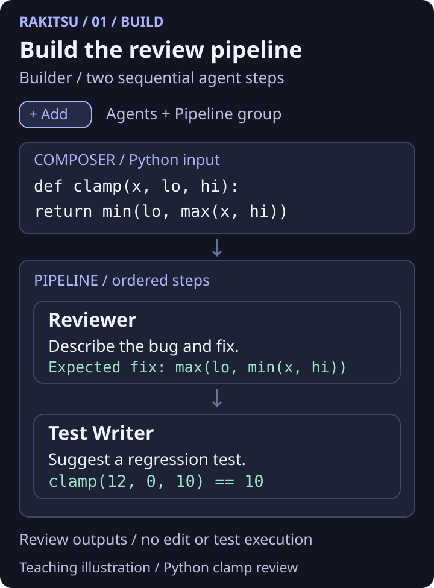
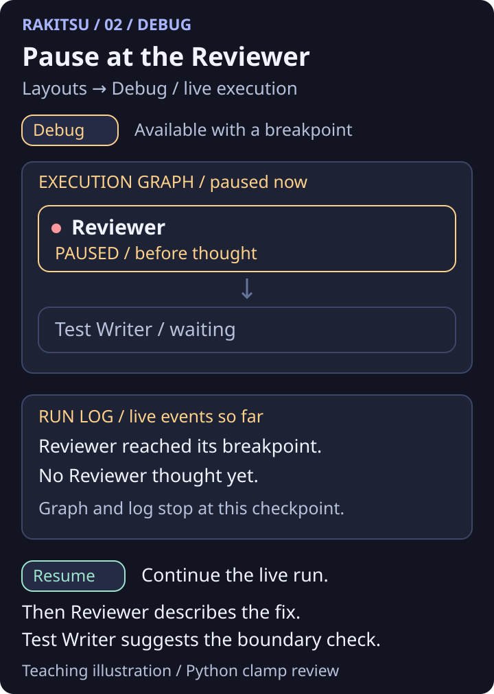
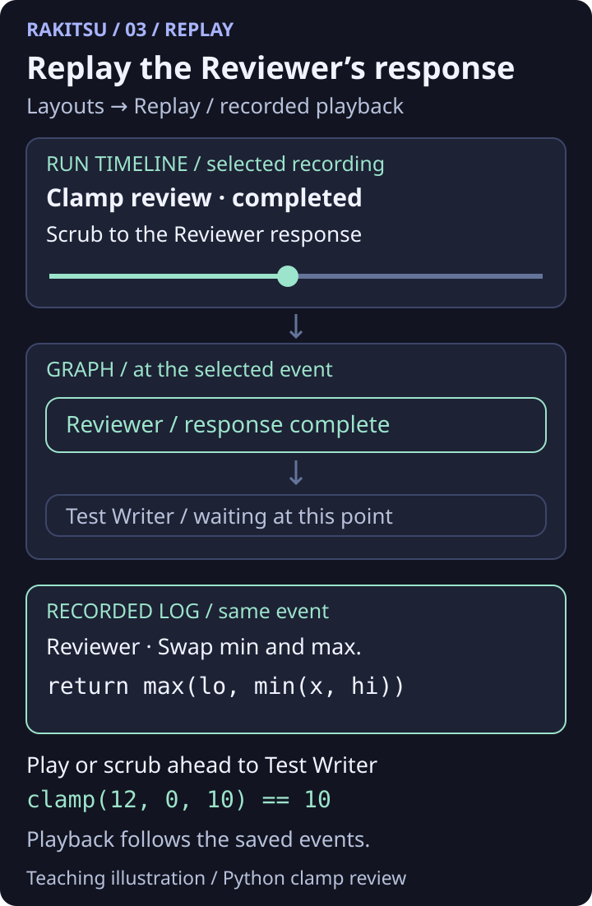

# Rakitsu Web UI Manual

[日本語](WEBUI.ja.md)

## Overview

This manual describes the 0.4.0 development workspace.

The rakitsu web UI is a full-featured agent IDE accessed via `rakitsu serve`. The workspace has seven dockable panels:

- **Builder** — Visual drag-and-drop agent configuration
- **Debugger** — Real-time execution monitoring with breakpoints
- **Inspector** — Event stream viewer
- **Sessions** — Session history and inspection
- **Chat** — Interactive agent conversations
- **Run Log** — Events for the latest run, a selected session, or all received events
- **Run Timeline** — Playback and event details for a recorded run

Start the UI:
```bash
rakitsu serve --port 9100
# Open http://localhost:9100
```

**First launch, nothing in the config list?** `serve` only shows configs
found under `.`, `./examples`, `./configs` (or `--config-dir`), relative to
wherever you ran it from. If you don't have a project yet, run `rakitsu
quickstart` first — or open `examples/` and pick one to try the UI against
before writing your own config.

---

## Workspace layouts

Use **Layouts → Debug** to put Builder beside the Debugger Block graph, with
Run Log and Run Timeline below. The log follows the latest web run until you
choose another source. Use **Layouts → Replay** to give the execution graph
more space. Choose a recording in Run Timeline and use **Play** or the slider
to move the graph and recorded log together. Switching presets keeps the
selected recording and playback position. In narrow windows the panes stack.

Use a pane’s **⋯** menu to float, dock, maximize, or join another tab group.
Drag a pane by its tab or floating title bar to snap it into place.
In Builder, use the composer chevron to collapse the prompt controls and
free canvas space. The prompt and run settings are kept when you expand it.
Recent runs appear in the Builder footer.

[Watch the 0.4.0 Web UI walkthrough](assets/showcase/web-ui-workbench.mp4).
It shows a pipeline in Builder, a breakpoint in the Debug layout, and a
recorded run in the Replay layout.

<a id="build-debug-and-replay-a-code-review"></a>

## Example workflow for a Python code review

These teaching diagrams follow a two-agent review. The recordings show the
workspace in use, including a separate Retrieval → Decision pipeline that
runs without agents.

1. **Build the two steps.** In **Settings**, configure a provider and model.
   Use **+ Add** to create an Orchestrator, a Pipeline group, and two agents
   named Reviewer and Test Writer. Connect the Orchestrator to the group. Drag
   both agents into the group and confirm **Add to group**. Place Reviewer
   above Test Writer so the pipeline runs them in that order. Ask Reviewer to
   describe the bug and fix, and Test Writer to suggest a regression test
   from the review. Enter this Python input in the Builder composer.

   ```python
   def clamp(x, lo, hi):
       return min(lo, max(x, hi))
   ```

   The `min` and `max` calls are reversed. The intended fix is
   `max(lo, min(x, hi))`. The suggested test is `clamp(12, 0, 10) == 10`.
   The agents propose the fix and the test in their responses.

   

2. **Debug the live run.** On Reviewer, use the Builder context menu's
   **Break before thought** action. The composer offers **Debug** when a
   breakpoint is set. Choose **Layouts → Debug**, then start with **Debug**.
   At the breakpoint, inspect the paused Reviewer in the graph and the events
   received so far in **Run Log**. The Reviewer's thought has not run yet and
   Test Writer is waiting. Click **Resume** to continue the live execution.
   Let both steps finish so the completed recording is available for replay.

   

3. **Replay the completed recording.** Choose **Layouts → Replay** and select
   that completed run in **Run Timeline**. Scrub the slider to the Reviewer's
   completed response. The graph and recorded **Run Log** follow the same
   event, where Reviewer has described the fix and Test Writer is still
   waiting. Use **Play** or scrub forward to the Test Writer's suggested
   `clamp(12, 0, 10) == 10` check. Playback moves the viewing position
   through the saved events.

   

## Visual Builder

Use **+ Add** to create nodes and groups. Hover over an icon to see its
action. Use **Tab** to reach the choices in **+ Add**, and **Esc** to close it
and return focus to the button. The composer shows **Run**, or **Debug**
when a breakpoint is set.

Choose **SVG workbench preview** in the toolbar to switch canvases. **Classic
canvas** returns to the default view. **Arrange** lays out the SVG preview
left to right. Use the fold control on a group, or **Fold all** and
**Unfold all** in the toolbar.

Builder opens the **Execution Path** when a run starts. Use **Show
Workflow** to see the configured graph while it runs. After a run, **Back to
Canvas** restores editing and **Show Results** opens the execution graph again.

### Canvas Basics

| Action | How |
|---|---|
| Pan canvas | Click and drag on empty space |
| Zoom | Scroll wheel or pinch |
| Fit view | Click the fit-view button in bottom-left controls |
| Add node | Open **+ Add** and choose Agent, Tool, Skill, or Orchestrator |
| Move node | Click and drag a node |
| Connect nodes | Drag from a source handle to a target handle |
| Edit node | Click a node to open the side panel editor |
| Delete node | Select node(s), press Delete or Backspace |
| Right-click menu | Right-click any node for context actions |

### Node Types

| Type | Purpose | Handles |
|---|---|---|
| **Agent** | LLM-powered worker or supervisor | In (top), Out to tools/skills (bottom) |
| **Tool** | CLI command, filesystem operation, MCP server call, or A2A delegation | In (top) |
| **Skill** | Reusable tool+prompt combination | In (top) |
| **Orchestrator** | Manages agent coordination strategy | In (top), Out to agents (bottom) |
| **Group** | Container block for grouping nodes | In (top), Out (bottom) |
| **Decision** | Asks typed questions and can route to agent steps | Branch wires come from the Decision configuration |
| **Retrieval** | Searches a local document corpus and returns cited passages | An evidence wire connects to a Decision configured to use the results |

Select a pipeline group to enable **Decision** and **Retrieval** in **+ Add**.
Open the Decision editor to set its backend, questions and routes.
Set the corpus directory in the Retrieval editor and start `rakitsu serve`
with `RAKITSU_RETRIEVAL_ROOT` pointing at the approved corpus. See the
[pipeline reference](reference/agents-orchestrators.md#decision-and-retrieval-steps)
for the evidence input rules.

### Connection Rules

| Source | Valid Targets |
|---|---|
| Orchestrator | Agent, Orchestrator, Group |
| Agent | Tool, Skill, Agent, Orchestrator, Group |
| Group | Agent, Tool, Skill, Orchestrator, Group |
| Tool | (leaf node — no outgoing connections) |
| Skill | (leaf node — no outgoing connections) |

---

## Multi-Select

| Action | How |
|---|---|
| Box select | **Shift + drag** on empty canvas |
| Toggle node | **Cmd + click** (Mac) / **Ctrl + click** (Win) |
| Select all same level | Shift+drag covers all nodes at current scope |
| Deselect all | Click empty canvas or press **Escape** |

### Bulk Operations

When multiple nodes are selected, a **Bulk Edit** panel appears:
- Shows count and types of selected nodes
- If all same type (e.g., all agents): edit shared fields (provider, model)
- **Duplicate** — clones all selected nodes + internal edges
- **Delete** — removes all selected with confirmation

---

## Block Programming (Groups)

### Creating Groups

| Method | How |
|---|---|
| Empty group | Open **+ Add** and choose **Pipeline**, **Parallel**, **Team**, **Loop**, or **Group** |
| Group selection | Select two or more nodes, then use the **Group selection** icon |
| Right-click menu | Multi-select → right-click → "Group as Pipeline/Parallel/Team" |

### Group Types

| Type | Color | Execution Meaning |
|---|---|---|
| **Pipeline** | Blue | Children execute sequentially (top to bottom) |
| **Parallel** | Green | Children execute concurrently |
| **Team** | Pink | Children managed by orchestrator (hierarchical) |
| **Generic** | Gray | Visual grouping only — no execution semantics |

### Adding Nodes to Groups

| Method | How |
|---|---|
| Drag and drop | Drag a node over a group → release → overlay menu "Add to group" |
| Nested groups | Drag a node over a nested group → deepest matching group is targeted |
| Re-parent | Drag a node from one group to another → moves between groups |

During drag, the target group **highlights with a blue glow** to show where the node will land.

### Removing Nodes from Groups

| Method | How |
|---|---|
| Ungroup all | Select group → click **Ungroup** or right-click → Ungroup |
| Drag out | (Enter group scope first, then drag node outside) |

### Group Properties

- **Resizable** — select a group, drag the corner/edge handles
- **Minimum size** — 250 x 120 pixels
- **Connectable** — groups have input/output handles for edges

---

## Scope-Based Selection

Selection follows a **hierarchical scope model** (like Maya/Figma):

### Scope Navigation

The **scope widget** appears at the top center of the canvas:

```
[ Canvas ] | Enter: [ Pipeline ] [ Team ]     ← at root
[ Canvas ] / [ Pipeline ] [ ↑ Up ]            ← inside Pipeline
[ Canvas ] / [ Pipeline ] / [ Parallel ] [ ↑ Up ]  ← nested
```

| Action | How |
|---|---|
| Enter a group | **Double-click** the group, or click its name in the scope widget |
| Exit group | Press **Escape**, or click **↑ Up**, or click a parent in the scope path |
| Jump to root | Click **Canvas** in the scope widget |

### Selection Rules

1. **Same-level only** — you can only select nodes at the current scope level
2. **Parent overrides children** — if a group is selected, its members can't be individually selected
3. **Selecting a group deselects its descendants** — cleans up conflicting selections
4. **Groups are selectable** — groups at the current scope level can be part of multi-select
5. **Mixed selection** — groups + regular nodes can be selected together at the same level

---

## Settings Panel

Open with the **gear icon** in the toolbar.

### Service Providers

Define LLM providers before configuring agents:

1. Click **+ Add Service Provider**
2. Set **Name** (e.g., "my-openai", "litellm-proxy")
3. Set **Type** (openai, anthropic, gemini, ollama, litellm)
4. Set **Default Model** — auto-discovers from proxy if base_url is set
5. Set **API Key** and **Base URL** as needed

### Defaults

- **Default Provider** — dropdown shows only defined providers
- **Default Model** — auto-discovers from the default provider
- **Temperature**, **Max Tokens** — propagated to agents via inherit/override

### Inherit/Override System

All auto-filled values follow an **inherit/override** pattern:

| Badge | Meaning |
|---|---|
| **inherited** (blue) | Value syncs with its source (e.g., provider's default model) |
| **reset** button | Click to go back to inherited from a manual override |

**Inheritable fields:**
- `model` ← provider's default_model
- `temperature` ← settings.defaults.temperature
- `max_tokens` ← settings.defaults.max_tokens
- `max_iterations` ← settings.execution.max_iterations
- `timeout` ← settings.execution.timeout_seconds

Changing the source (e.g., provider default model) automatically updates all agents with inherited values. Manually overridden values are never touched.

---

## Referential Integrity

All entities have **internal stable IDs** (`_id`). References survive renames:

| Rename | Auto-updates |
|---|---|
| Provider renamed | All agent/orchestrator `provider` fields |
| Tool renamed | All agent `tools[]`, all skill `tools[]` |
| Skill renamed | All agent `skills[]` |
| Agent renamed | Orchestrator `agents[]`, pipeline step `agent` refs |

IDs are stripped on YAML export — clean output with no internal metadata.

---

## Node Editor

Click any node to open the side panel editor.

### Agent Fields

| Field | Description |
|---|---|
| Name | Agent identifier (used in YAML + references) |
| Role | `worker` or `supervisor` |
| Provider | Select from defined providers |
| Model | Auto-discovers from provider, or type custom |
| System Prompt | Agent instructions (multi-line text) |
| Tools | Chip multi-select from canvas tools + custom input |
| Skills | Chip multi-select from canvas skills |
| Vision | Enable image input support |
| Model Config | Temperature, max tokens, top P, penalties |
| Agent Settings | Max iterations, timeout, reflection, ground check |

### ComboBox Dropdowns

All dropdowns use a custom **ComboBox** component:
- Click to open dropdown with all options
- Type to filter (incremental subsequence matching)
- Toggle **A/F** button to switch between "show All" and "Filter" mode
- Custom values accepted (type and press Enter)

---

## Debugger

### Modes

| Mode | Description |
|---|---|
| **Run** | Execute agent, stream events (no debug overhead) |
| **Debug** | Attach debugger with breakpoints, pause/resume, param override |

### Session Panel (right side)

- **Live** tab — active and recent runs
- **History** tab — past sessions from the JSONL session store
- **Search** — incremental chip-based filter (name, query, agent, status, config path)
- **Delete** — single or bulk delete with confirmation
- **Resizable** — drag left edge to resize

### Visualization Styles

Switch using the **Tree** and **Block** buttons or open the other graph styles:

| Style | Best For |
|---|---|
| **Tree** | Hierarchical view, compact, most detail |
| **Block** | Execution cards and the visual path through the run |
| **Timeline** | Time-based horizontal view |
| **Mind Map** | Organic radial layout |

### Breakpoints

Set breakpoints to pause execution at specific points:

| Method | How |
|---|---|
| Breakpoint bar | Select event type + agent name in the toolbar |
| Tree context menu | Right-click a node → "Set Breakpoint" |
| Inline buttons | Select a tree node → click **BP** button |
| Builder context menu | Right-click agent node → "Break before thought/tool/agent" |

**Supported checkpoints:**
`AGENT_START`, `THOUGHT_START`, `THOUGHT_END`, `TOOL_CALL_START`, `REFLECTION_START`, `GROUND_CHECK_START`, `PIPELINE_STEP_START`

### While Paused

| Action | Description |
|---|---|
| **Resume** | Continue execution normally |
| **Step** | Advance to next checkpoint |
| **Step In** | Enter the next sub-agent |
| **Step Out** | Resume until leaving current agent |
| **Run to Here** | Resume until reaching a specific node |
| **Stop** | Cancel execution |

### Paused Node Indicators

| Visual | Meaning |
|---|---|
| Orange pulsing background | Node is paused |
| ⏸ icon + "PAUSED" badge | Paused at this node |
| Red dot in gutter | Breakpoint set on this agent |
| Green background + spinner | Currently executing |
| Live status line | Shows what agent is doing (streaming text, tool call, etc.) |

### Debug Experimentation

While paused, override parameters in the Detail Panel:
- **System Prompt** — modify the agent's instructions
- **Max Iterations** — change iteration limit
- **Tools** — enable/disable specific tools
- **Sticky** toggle — override persists across resumes or applies once

### Debug from History

| Action | Where | What it does |
|---|---|---|
| **Run to Here** | Tree node (live debug) | Resumes until reaching that node |
| **Debug from Here** | Tree node (history) | Re-runs session in debug mode, pauses at that node |
| **Rerun** | Session panel | Re-launches a past session |
| **Inspect in Builder** | Session panel | Loads session config into the visual builder |

---

## Import / Export

### Import

| Format | How |
|---|---|
| Single YAML | **Import → Import YAML** |
| Modular directory | **Import → Import Directory** |
| Scaffold template | **Scaffold**, then choose a preset |

### Export

| Format | How |
|---|---|
| Single YAML | **Export → Export YAML** |
| Modular ZIP | **Export → Export Modular (ZIP)** |

Internal fields (`_id`, `_providerId`, `_inherited`) are automatically stripped on export.

### Pipeline Import

When importing a config with `orchestrator.strategy: Pipeline`:
- Pipeline steps become **Pipeline group** blocks
- Parallel steps become nested **Parallel group** blocks
- Agents are placed inside their respective groups

---

## Environment Variables

Set env vars for agent execution in the Run dialog:
- Add key-value pairs in the **Environment** section
- Variables are scoped to the execution only (not set on the server process)
- Use `${VAR_NAME}` syntax in YAML configs to reference them

---

## Keyboard Shortcuts

| Key | Action |
|---|---|
| **Delete** / **Backspace** | Delete selected nodes |
| **Escape** | Exit group scope / deselect all |
| **Shift + drag** | Box select multiple nodes |
| **Cmd + click** | Toggle node in multi-selection |
| **Double-click group** | Enter group scope |
| **Cmd + Enter** | Run (in run dialog) |

---

## Workspace Directory

Set the working directory for tool execution:
- **Builder run dialog** — workspace field with orange warning if empty
- **RunLauncher** (session panel) — same field
- Tools execute relative to this directory
- Persists across runs in the session

---

## Tips

- Use **scaffold templates** to get started quickly
- Define **providers in Settings first**, then agents will auto-populate model lists
- Set **default_model on each provider** — new agents inherit it automatically
- Use **Pipeline/Parallel groups** to visualize execution order
- **Double-click groups** to edit children inside
- The **inherit system** keeps settings in sync — use "reset" to go back to defaults
- **Right-click** any node for quick actions (breakpoints, duplicate, delete, group)
